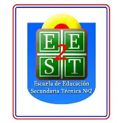
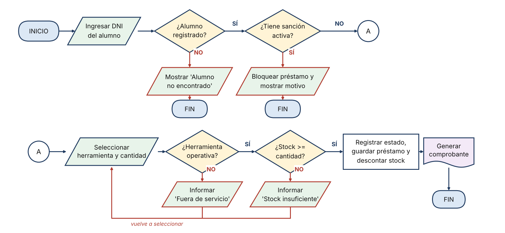
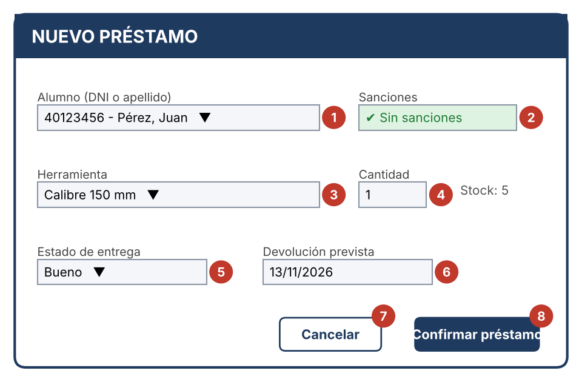
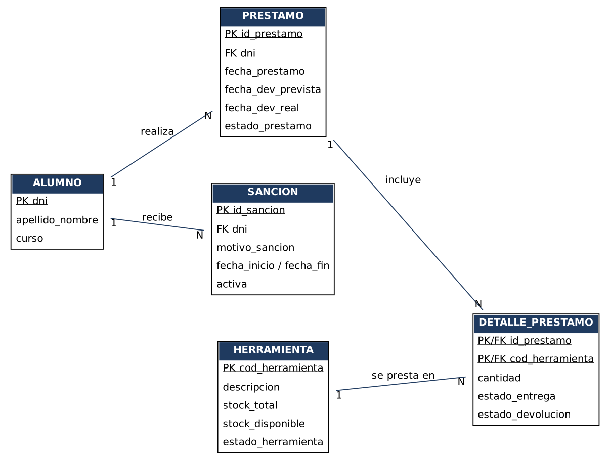
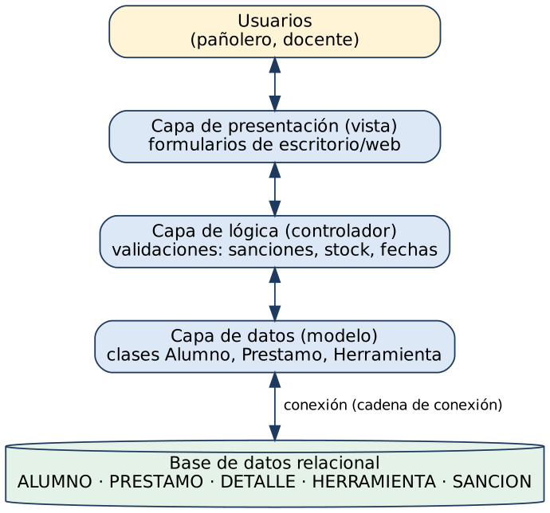

<p align="center">
  
</p>

<h1 align="center">Sistema de Gestión de Préstamos de Pañol Escolar</h1>

<p align="center">
  Trabajo Integrador Individual · Escuela de Educación Secundaria Técnica N.º 2<br>
  Opción A: documentación técnica y de usuario
</p>

---

## Descripción

El pañol de un taller escolar presta herramientas e insumos a los alumnos. Llevar ese circuito en papel genera errores de stock, herramientas que no vuelven y sanciones que nadie recuerda.

Este proyecto documenta un **sistema de gestión de préstamos de pañol** que permite:

- Dar de alta, baja y modificar **alumnos** y **herramientas** (ABM).
- Registrar **préstamos** validando alta del alumno, sanciones, estado de la herramienta y stock.
- Registrar **devoluciones** controlando el estado en que vuelve cada herramienta.
- Generar **sanciones automáticas** por demora o daño.
- Consultar el **historial** de préstamos por alumno y por herramienta.
- Emitir **reportes** de stock e insumos dañados.

**Fuera de alcance:** compra de insumos, facturación e integración con sistemas externos de la escuela.

## Documento principal

📄 [`docs/Documentacion_Sistema_Gestion_Panol.docx`](docs/Documentacion_Sistema_Gestion_Panol.docx)

| Sección | Contenido | Para quién |
|---|---|---|
| Introducción | Objetivo, alcance, normas y control del documento | Todos |
| Apartado 1 | Marco conceptual: documentación de usuario vs. técnica | Docentes |
| Apartado 2 | Instructivos paso a paso (préstamo y devolución) | Usuarios |
| Apartado 3 | Diagramas de flujo (ISO 5807) | Equipo técnico |
| Apartado 4 | Casos de uso formales CU-01 y CU-02 (UML) | Equipo técnico |
| Apartado 5 | Capturas anotadas de la interfaz | Usuarios |
| Anexo A | DFD, diccionario de datos, DER, estados, tabla de decisión | Equipo técnico |
| Anexo B | Clases, cursograma, Git, Gantt, PERT | Equipo técnico |
| Anexo C | Requerimientos, arquitectura, instalación, pruebas, glosario | Equipo técnico |

## Vista rápida

### Proceso de préstamo


### Interfaz "Nuevo préstamo"


### Modelo de datos (DER)


### Arquitectura en tres capas


## Reglas de negocio

| Código | Regla |
|---|---|
| RN-01 | No se presta a alumnos con sanción activa. |
| RN-02 | No se presta más que el stock disponible. |
| RN-03 | Solo se prestan herramientas operativas. |
| RN-04 | La devolución prevista es de 7 días corridos por defecto (editable). |
| RN-05 | La devolución fuera de término genera sanción. |
| RN-06 | Una herramienta con daño pasa a reparación y genera sanción. |
| RN-07 | Una devolución parcial deja el préstamo Activo por el saldo. |

## Requerimientos

**Funcionales:** RF-01 ABM · RF-02 préstamos · RF-03 devoluciones · RF-04 sanciones automáticas · RF-05 historial · RF-06 reportes.

**No funcionales:** RNF-01 usabilidad · RNF-02 seguridad (roles Pañolero y Responsable) · RNF-03 integridad del stock · RNF-04 copia de seguridad diaria · RNF-05 trazabilidad.

## Modelo de datos

Tablas: `ALUMNO`, `PRESTAMO`, `DETALLE_PRESTAMO`, `HERRAMIENTA` y `SANCION`.

- Alumno 1:N Préstamo · Préstamo 1:N Detalle · Herramienta 1:N Detalle · Alumno 1:N Sanción.
- La relación N:M entre Préstamo y Herramienta se resuelve con `DETALLE_PRESTAMO`.
- Estados de préstamo: `Activo`, `Devuelto`, `Vencido`.

## Instalación y despliegue

Resumen del manual completo (Anexo C.3):

1. Preparar un equipo con un motor de base de datos relacional y el entorno de ejecución del sistema.
2. Crear la base de datos y ejecutar el script que genera las tablas.
3. Configurar la cadena de conexión (servidor, puerto, base, usuario y contraseña) en un archivo de configuración local. **No subir credenciales al repositorio.**
4. Clonar el repositorio y compilar o instalar la aplicación.
5. Crear el usuario administrador inicial y cargar el inventario de herramientas.
6. Probar con un préstamo de prueba y configurar la copia de seguridad diaria.
7. Registrar la versión instalada con un tag de Git.

## Plan de pruebas

| ID | Caso | Resultado esperado |
|---|---|---|
| CP-01 | Préstamo correcto | Préstamo registrado, stock − cantidad |
| CP-02 | Alumno con sanción | Se bloquea y muestra el motivo |
| CP-03 | Stock insuficiente | Error, no se guarda |
| CP-04 | Alumno inexistente | "Alumno no encontrado" |
| CP-05 | Devolución en término | Préstamo Devuelto, stock + cantidad |
| CP-06 | Devolución con daño | Sanción y herramienta en reparación |
| CP-07 | Devolución tardía | Demora registrada y sanción |

## Estructura del repositorio

```
panol-gestion/
├── README.md
├── .gitignore
└── docs/
    ├── Documentacion_Sistema_Gestion_Panol.docx
    └── img/            # Figuras 1 a 13 y logo
```

## Flujo de trabajo con Git

Rama `main` estable y una rama por funcionalidad. Mensajes de commit descriptivos.

```bash
git checkout -b funcionalidad-sanciones
git add .
git commit -m "Alta de clase Prestamo"
git push origin funcionalidad-sanciones
```

## Normas aplicadas

- Diagramas de flujo: ISO 5807
- UML 2.5.1 (OMG) y casos de uso según Cockburn (2001)
- Requerimientos: ISO/IEC/IEEE 29148
- Documentación de usuario: IEEE Std 1063-2001
- Citas y referencias: APA 7.ª edición

## Versiones

| Versión | Fecha | Descripción |
|---|---|---|
| 0.1 | — | Borrador: apartados 1 a 5 |
| 0.2 | — | Incorporación de Anexos A y B |
| 1.0 | 06/11/2026 | Versión final: Anexo C, flujos ISO, referencias APA |

## Autoría

Alumno/a: _completar_ · Curso/Año: _completar_ · Materia: _completar_
